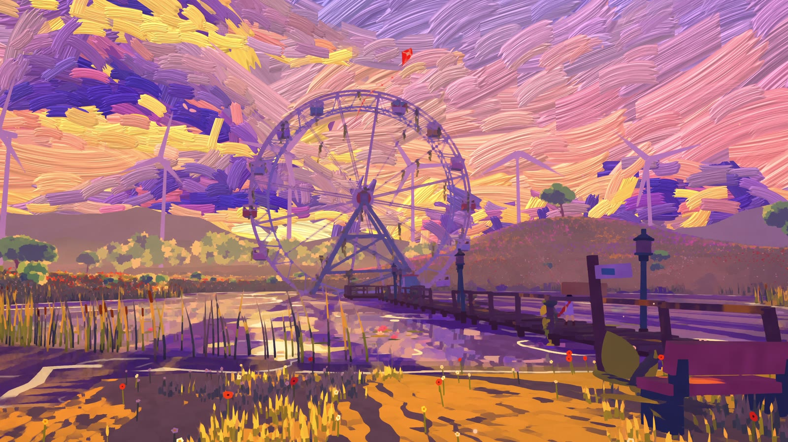
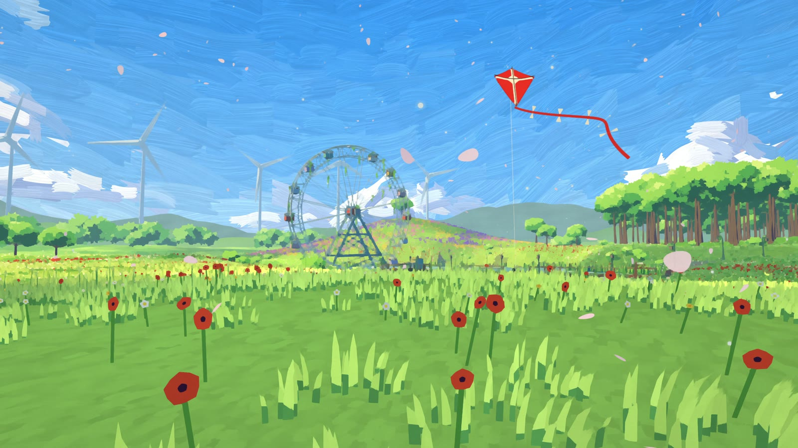
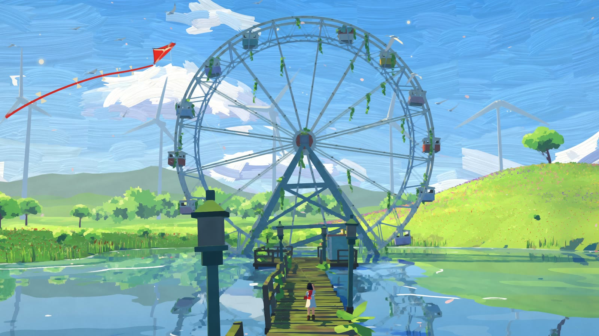
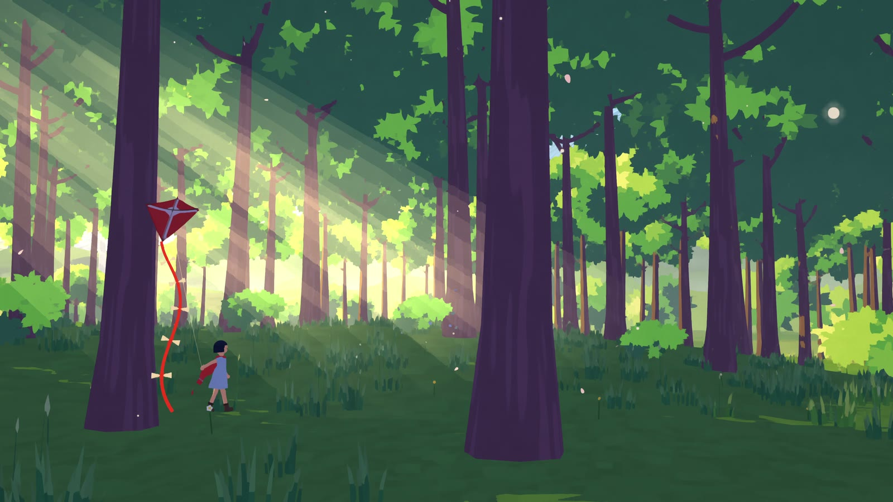
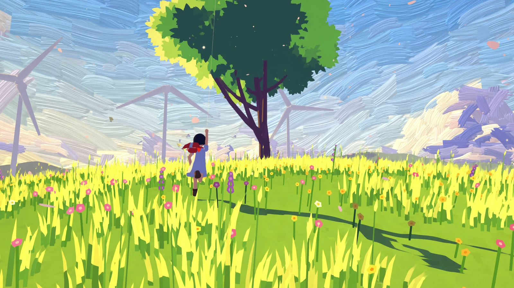
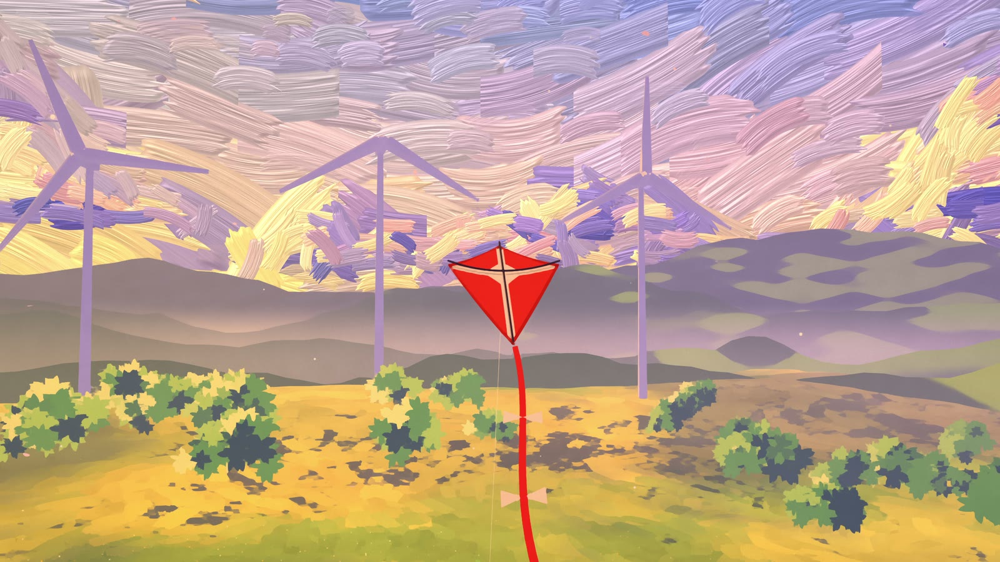
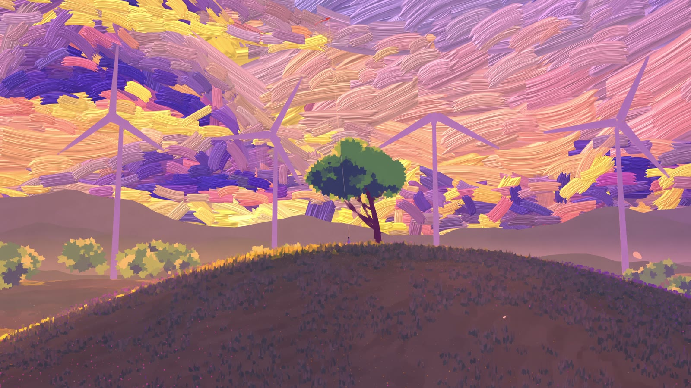
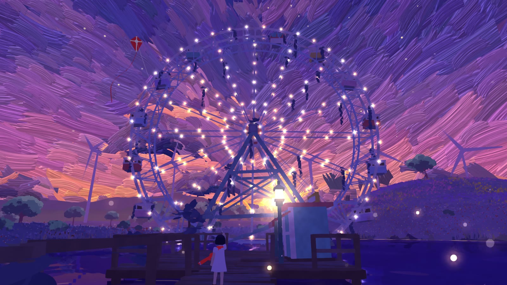

# beautiful wonderland



A small painted world in three.js, and a 40-second 4K film rendered from it frame by frame in the browser.

**The film — "the wind still remembers".** A child with a red kite crosses a world that nature has quietly
taken back: a poppy meadow, an overgrown Ferris wheel half-sunk in a pond, a forest glade, a hill with one
tree. The day runs from azure noon through golden hour into a huge impasto sunset; at dusk the old lamps come
back on one after another and the wheel lights up and turns again.

| | |
|---|---|
|  |  |
|  |  |
|  |  |
|  | |

## Run the live demo
```bash
npm install
npm run dev
```
Open http://127.0.0.1:5173/ — the film plays in real time and loops. `Space` pauses, `←` / `→` scrub.
Quality: add `?q=high` (paint filter on, denser grass) or `?q=film` (everything, slow on small GPUs); the
default `live` preset runs at ~45 fps on a Radeon 780M. The first load compiles shaders for 10–30 s.
The demo is silent until you build the soundtrack (see Audio); then one click turns the sound on.

## How it is painted
- **Paint space**: every colour is a final on-screen value, mixed the way a painter mixes by eye. Four hand-picked
  palettes (noon, golden hour, sunset, dusk) drive every material through shared uniforms (`src/core/env.js`).
- **The sky is a painting wrapped around the viewer** (`src/world/sky.js`): a colour study of lit cumulus and
  cirrus is rendered into a strip, then four layers of oriented brush strokes take their paint from it. Strokes
  follow cloud contours and fan out from the sun, carry bristle relief lit from the upper left, and are anchored
  to the canvas — so the camera moves across a stable painting that slowly lives.
- **The ground is painted with the same stroke generator** in world space, at a constant on-canvas size.
- **Everything else is flat shapes**: two-tone light with a hand-cut terminator, hue-shifted cool shadows,
  leaf-clump cut-outs, per-blade flat tones, then an anisotropic Kuwahara filter merges detail into dabs.
- **Wind is the motif**: one gust function moves grass, flowers, reeds, leaves, scarf, kite and water.
- The film is a pure function of time (`src/film/timeline.js`): cuts sit on the music's downbeats, the sunset
  arrives on the full-ensemble entry, lamps switch on to the beat.

## Render the film yourself
```bash
node tools/render.mjs --name final --size 3840x2160 --tiles 4x4   # 1200 PNG frames, resumable
node tools/mix.mjs                                                 # assets/audio/mix.json -> out/audio/mix.wav (-14 LUFS)
node tools/encode.mjs --name final --audio out/audio/mix.wav --out out/video/beautiful_wonderland_4k.mp4 --crf 15 --x
node tools/shot.mjs --name look --t 0,5,12,24,35 --sheet           # stills at film times
```
Needs Node 22, ffmpeg and a local Chrome or Edge (the capture tools drive it headless). 4K frames are rendered
in 16 tiles so no single draw call runs long on an integrated GPU, and only one GPU job runs at a time; the full
film took about 1 h 20 min on a Radeon 780M. More in `docs/RENDERING.md` and `docs/ENGINE.md`.

## Audio
The music and sound effects are third-party recordings under free licences. Several of those licences allow use
in a project but not redistribution of the files themselves, so none of the raw audio is in this repository.
`assets/audio/CREDITS.md` lists every file with its source page, download URL and licence, and
`assets/audio/mix.json` is the mix. To rebuild the soundtrack, download the files into `assets/audio/music/`
and `assets/audio/sfx/` under the names used in `CREDITS.md`, then:
```bash
node tools/mix.mjs
mkdir -p public/audio && ffmpeg -i out/audio/mix.wav -b:a 192k public/audio/mix.mp3   # for the live demo
```
Music: "Classical 3" by Jonny S. (Mixkit Stock Music Free License). Sound effects: Mixkit and Freesound (CC0).

## Not in this repository
- The rendered videos (3840×2160 master and a 1080p version): each is larger than GitHub's 100 MB file limit.
- The reference paintings that set the style brief: they are other artists' work. Only their design language was
  studied; every motif in this world is original.

## Layout
`src/core` renderer, palettes, materials, pipeline · `src/world` sky, terrain, layout · `src/world/parts`
grass, flora, water, props (wheel, jetty, lamps, turbines), actors (child, kite, birds, fireflies) ·
`src/film` timeline · `tools` capture, render, encode, mix, QC · `docs` engine and rendering notes, stills.
